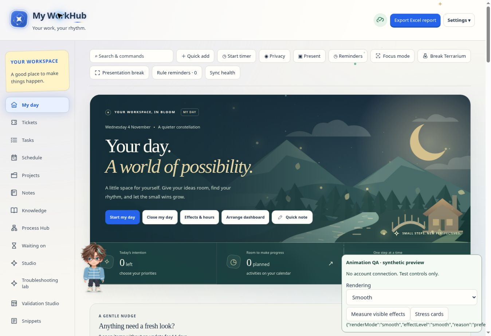

# Animation performance

The existing **Display rendering** setting now updates the actual effects immediately. It changes presentation only: it does not alter records, validation rules, exports, timers, audio or saved widget positions.

| Mode | Decorative behavior |
| --- | --- |
| **Automatic · adapt to display and performance** | Ordinary displays start with 14 particles, one orbit, two comets and at most six visible card glows. High-resolution displays, devices reporting at most two logical processors or 2 GB of memory, and sustained slow rendering use the lighter path. |
| **Smooth · lighter animations** | Eight particles, no large orbit/comet layers, pointer bursts or card glows, and lighter painting. Trees, river motion, the companion, focus controls and the visible terrarium remain available. Works on ordinary screens as well as large displays. |
| **Full effects** | Restores the previous desktop effect counts immediately: 32 particles, three orbits, five comets and all visible card glows. Existing iPhone safety limits remain in place. Motion-off, reduced-motion and privacy controls continue to take precedence. |

Automatic checks short, local frame windows after loading and occasional interaction. Sampling is deferred, rate limited to once per 20 seconds, and ends after at most 65 frame callbacks. Two consecutive poor 32-frame windows, or four consecutive severely delayed frames, select the lighter path. One isolated long task does not. Hidden pages, reduced-motion/off preferences, covered rest scenes and suspended-page gaps do not produce a downgrade. There is no continuous monitoring loop, network request or saved performance history.

An Automatic fallback remains for the current Automatic session to avoid repeated quality changes. Switching rendering mode or reloading starts a fresh evaluation. The account preference remains Automatic; choosing Smooth or Full explicitly follows that saved choice. Large-display threshold hysteresis is retained.

## Work removed

- The global renderer previously captured its budget only at page load. It now refreshes its sky layers, reaction limits and intersecting-card budget on rendering changes, without rebuilding forms or replacing inputs.
- Default desktop card glows are capped at six. Full effects retains the previous behavior. Smooth removes the decorative aura nodes entirely and restores them when required.
- Click and pointer feedback share one expiry timer instead of scheduling a timer for every particle. Both live nodes and pending cleanup work are bounded. Automatic pointer trails are less frequent and skip the additional streak/full-page sweep.
- Header letters retain their small, staggered transform animation in lighter profiles, without gradient or shadow painting; the complete title does not animate as a second layer. Symbol and terrarium breathing effects use transforms/opacity rather than animated shadows. Theme colours and privacy redaction remain intact.
- My Day avoids scheduling tilt and parallax work in Smooth. Offscreen scenery continues to pause in every profile, and profile changes cancel pending decorative frames. The full-screen rest scene clears the covered global decorations while retaining its own plant, water, music and Resume work behavior.

## Functionality and verification

The implementation changes `render-profile.js`, `dramatic-motion.js`, `my-day-visuals.js`, the profile CSS and rendering-option labels. No backend/schema, account-persistence, audio or validation-engine changes are needed. The existing functional clocks and audio APIs are never wrapped, replaced or paused by the performance sampler.

Automated coverage checks live Automatic/Smooth/Full changes, focused input values and selection, drag attributes and widget identity, newly opened dialogs, bounded reaction cleanup, offscreen scenery, privacy blur, severe/isolated/hidden frame cases, iPhone limits and display hysteresis. The wider module/database and application suites cover the functional workflows, including validation uploads, explosion/comparison/correction/export, drag-and-drop, focus, break completion, audio and presentation screens.

Release verification passed 739 module/database checks and 432 application checks across the five application groups, plus the focused animation/style rechecks after the final CSS adjustment.

In the isolated synthetic browser preview, the previous desktop/Full workload had 32 particles and 24 glowing sample cards. Automatic's normal budget showed 14 particles and at most six glowing cards; sustained slow frames selected eight particles and no glows. Explicit Full restored the original counts, and Smooth retained an edited `001 / 6.00007` field value. A focus countdown progressed, paused for a break, and resumed after the break's completion/Resume work path. Automatic full-screen entry was unavailable in that browser, so the existing full-window fallback was exercised.

These are workload and regression checks, not a frame-rate guarantee for every device. Automated-browser frame pacing is not a reliable benchmark of a physical desktop or phone.

