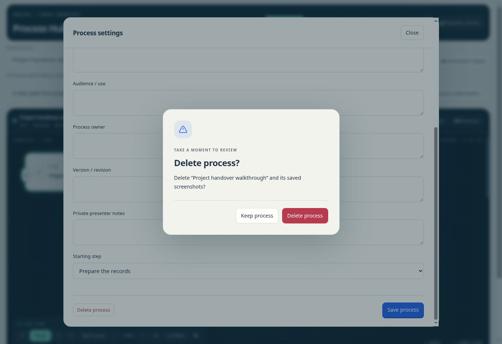
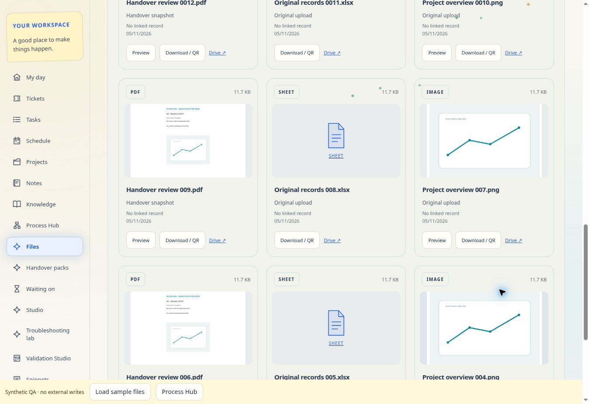

# File gallery and website dialog verification

5 November 2026 · source tested against the existing GitHub Pages application.

## Automated checks

- 801 module/database tests passed, including the real confirmation component, Drive media byte and stream limits, preview lifecycle, thumbnail bounds, access controls, Process Hub fullscreen host preservation and validation undo/version/reference behavior.
- 84 broader application checks passed in a bounded-memory group, covering affected feedback, project, cloud, recipient, validation and work-session paths. An earlier unpartitioned run reached 78 passing checks before exhausting Node's default test heap; it was replaced by the bounded 4 GiB run. No application assertion failure remained.
- The focused Files/Projects/Settings and validation application groups passed (25 and 16 checks), along with all three new gallery, preview routing and actual-dialog task-deletion integrations.
- `git diff --check` passed. A parser-based audit verifies that shipped app modules contain no native `confirm`, `alert` or `prompt` calls. Browser-owned beforeunload protection is unchanged.

## Browser checks

A separate static preview used a synthetic account, synthetic Drive responses and disposable process records. No real account records, Google permissions or Drive files were changed.

- Gallery displayed 12 cards then four on page two. PDF first-page and PNG thumbnails loaded only on request; spreadsheets retained type placeholders and Drive actions.
- The real local PDF.js worker rendered a two-page PDF, navigated to page two and retained the exact fixture text and image. PNG preview reported the correct 960 × 640 dimensions.
- The 390 px frame displayed a single-column gallery with a 375 px content width and no page-wide horizontal overflow. The PDF page fitted inside the viewer content area, with wrapped navigation controls.
- Process deletion opened the website's themed dialog, with initial Keep process focus and no native JavaScript popup. Cancel preserved the process. Approval removed only the disposable process and retained Full screen view, including when it was the last saved process.
- The unit integration separately checked the identical native fullscreen stage through cancellation, repaint and approval, with no exitFullscreen call. Native display/permission support remains browser-dependent.
- A visual check found and fixed Delete-button contrast under the existing global theme rules. The resulting button has a white label on its solid red background.

Actual Google OAuth consent and private media reads require the operator's own configured Google client and test account; synthetic transport tests do not certify that external setup.

