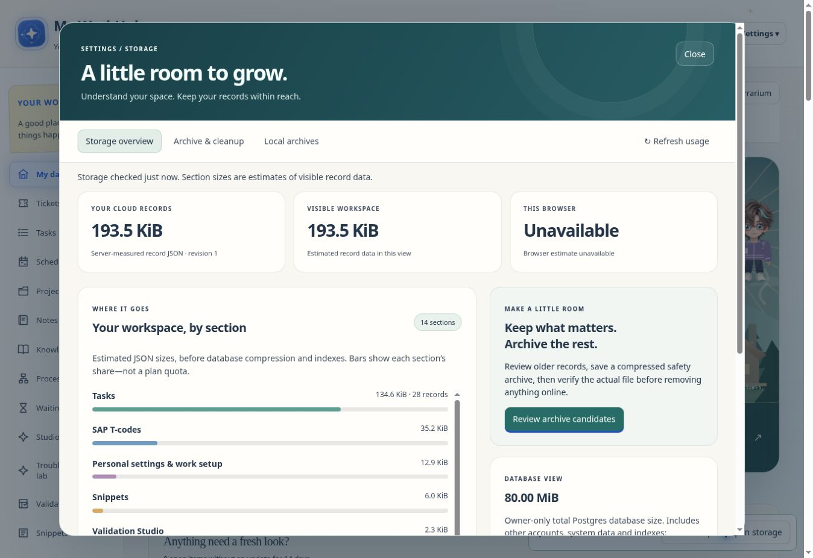

# Storage & cleanup

Open **Settings → Backups & sync → Storage & cleanup**, or search Settings for “storage”. The page works on demand; it adds no background polling, animation loop or automatic cleanup.

## Understand the measurements

- **Your cloud records**: server-measured UTF-8 JSON size of this account's saved record data, with its saved revision.
- **Visible workspace**: estimated JSON size of the records currently visible to this account. Per-section bars show shares of that estimate, not a percentage of a Supabase plan quota. Sections sharing a feature are grouped without counting the same data twice.
- **This browser**: the browser's origin-storage estimate and estimated capacity when the API is available. Browser reporting may exclude some device storage; unavailable estimates are labelled explicitly.
- **Database view**: the active Owner alone sees total Postgres database size, including other accounts, system data and indexes. This is not allocated disk, WAL, Supabase Storage bucket usage or a per-account bill. Postgres column storage for this account's document is also shown separately.

No plan quota is assumed. Logical JSON size and physical database size measure different things. Deletion makes space reusable; reported database size may not immediately shrink. See [Supabase's database-size guide](https://supabase.com/docs/guides/platform/database-size).

## Archive and clear selected records

1. Choose **Archive & cleanup**, a section and an optional “before date”. Undated records are excluded when a date filter is used. Candidates include completed tasks, closed tickets, completed project items, past schedule entries, validation run summaries, saved sessions, Notes Trash and scrapbook entries. Active tasks and unfinished project items are not candidates.
2. Select records using their checkboxes or **Select this page**. Lists show at most 25 records per page, with a scrollable record list.
3. Choose **Review selection**. The preview identifies records still referenced by retained records or settings, including nested sub-item references and ID-keyed maps. Those records stay online. A record's own workflow metadata, task profile or ticket closure date moves with its parent. Immutable historical timeline entries remain online and unchanged, using the existing deleted-record display behaviour.
4. **Download compressed archive** creates a lossless ZIP containing a complete workspace safety snapshot, a selection manifest and a README. Every value, ID and relationship is preserved as JSON; identifiers such as `001` and `6.00007` remain text. Export permission is required for the full visible workspace. The archive contains private data and is not encrypted.
5. Reopen the actual downloaded ZIP in the verification input. SHA-256 must match the exact ZIP produced for this review; a different file, corrupt payload or stale review cannot enable removal. Download initiation alone never permits deletion.
6. Type **REMOVE**, enter the current account password and submit. Only the reviewed removable records and their owned context are removed. Another account, browser tab, record change, cloud revision, pending save, permission change or active work timer blocks the operation. No actual account records are cleared merely by opening Settings, refreshing, creating an archive or verifying a file.

Keep the ZIP somewhere durable outside browser storage. Removed records disappear from other devices after sync. An uncertain network save requires reloading cloud records before another attempt; it is never automatically retried as a destructive operation.

## Inspect and selectively restore

Choose **Local archives** and open a WorkHub ZIP. Files are read locally; opening an archive does not upload or restore it. Inspect selected-record values, choose records and preview restoration. Very large record previews are capped at 50,000 displayed characters; archive values remain complete.

Only missing records are added. Required missing linked records and record-owned context are included, while differing or identical live records are kept unchanged. Ambiguous identifiers, conflicting uniqueness rules or invalid resulting documents block the restore. Review the additions, type **RESTORE** and verify the account password. Cross-account archives may be inspected locally, but cannot be restored through this tool.

The ordinary whole-workspace **Restore** and **Back up & clear all records** actions retain their existing behaviour.

## Boundaries and verification

Archives support a 16 MiB uncompressed workspace snapshot, a 24 MiB input ZIP and bounded decompressed entry sizes. They require HTTPS/Web Crypto for checksums. Compression uses the existing local JSZip library; no archive is stored back in Supabase. Changing live database records to compressed opaque blobs is outside this first version.

`storage-engine.js` owns accounting, dependency plans, checksummed ZIPs and missing-only restore. `storage-manager.js` owns the three-tab dialog and a password-checked revision-locked save via the existing `save_mm_tracker` RPC. `storage.css` is scoped to the new dialog; `settings-panel.js` registers its launcher in Backups & sync. The read-only migration adds a private, authenticated, account-scoped metrics function with a security-invoker public wrapper. No account rows, existing save functions, access policies or credentials were changed by the migration.

Tests cover Unicode/identifier fidelity, compressed archive integrity, exact downloaded-file verification, stale/account/permission/revision handling, uncertain saves, record dependencies and owned context, conflict-preserving restore, anonymous/suspended/member/Owner metrics access, and read-only Settings integration. Browser previews use synthetic records only. Desktop and a 390 px phone-width frame verify layout, selection, scroll controls and cleanup estimates. The managed HTTP preview lacks Web Crypto, so browser ZIP download/verification is not asserted; actual ZIP round trips and guarded cleanup/restore are exercised in automated tests using Web Crypto. Live database metrics and grants were verified read-only after migration; the security advisory baseline is unchanged.

