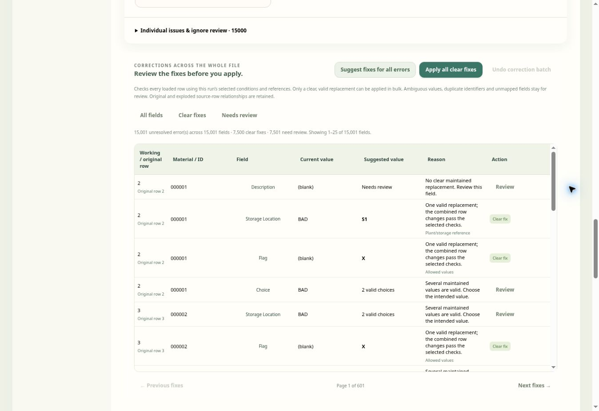

# Suggest and apply corrections across the whole file

Open **Validation Studio → Validate**, upload the file, review its mapping and selected checks, then choose **Run validation**. The **Corrections across the whole file** panel appears below What needs attention.

1. Choose **Suggest fixes for all errors**. The scan checks every loaded row, including errors beyond the normal 15,000-item issue list. It does not change the data.
2. Review the working/original row, material identifier, field, current value, proposed value and reason. Use **Clear fixes** or **Needs review** to filter the paged list. All pages belong to the same complete scan.
3. Choose **Apply all clear fixes** to apply the unambiguous proposals together. Studio stages the complete batch and revalidates the whole file before replacing the working data. Progress and **Cancel corrections** are available during pending work.
4. Choose **Review** for a field needing a decision. The maintained-value picker uses the other values in that same record and rechecks the file after your selection. If no maintained choice exists, edit the field in the records table.
5. **Undo correction batch** restores the cells changed by the latest batch and revalidates. Later edits to unrelated cells remain. If a corrected cell was edited again, undo refuses to overwrite it; review that row individually.

## What qualifies as a clear fix

The scan uses the selected run's template version, conditions, references and company context. It can propose a unique valid allowed/reference value, an explicit fixed value, equality to another maintained field, an explicit empty requirement, or configured SAP NUMC/CLNT/date/time formatting. Reference combinations keep the other values from that same row. The combined proposals for a row must pass the selected checks without adding another local error or warning; full-file validation checks the staged batch before it is committed.

Multiple valid choices, unknown required values, duplicate identifiers, members of unique combinations and unmapped fields remain **Needs review**. Fixing every error automatically is not guaranteed: a blank description or several valid storage locations needs the user's intended value. The tool does not infer descriptions from another material, round identifiers, truncate values or invent missing master data. Explicitly ignored issues are excluded from the plan.

Example: Plant P1 has one valid storage location S1, while P2 allows S2 and S3. Invalid storage on P1 can have a clear S1 proposal; P2 stays for review. If Flag requires the sole allowed value X, a blank Flag can be proposed as X. Choice values A and B require a decision.

## Data and session behavior

Only the proposed target cells change. Every working record retains its order, copied material/description fields, original worksheet row and exploded part. Original and prepared snapshots remain intact for comparison. Leading-zero identifiers and literal numeric text such as `6.00007` retain their exact strings unless that specific field has an explicit, reviewed correction. Exports reflect the revalidated current data; the issue workbook still contains exactly **Validated data** and **Issues**.

Changing the file, worksheet/header, mapping, version, selected checks, company or account invalidates an old plan. Editing a record or changing an ignore decision also requires a new scan. Undo belongs to the current file, mapping and validation session, and does not survive a new run, queue-file switch or page reload. A new successful correction batch replaces the previous batch's undo.

Large scans use a short-lived same-origin worker; unavailable workers fall back to cooperative local batches. Plans use compact arrays and render 25 review fields at a time. The scan supports the existing 25,000-record, 200-column and 5,000,000-cell limits; the working text limit is also checked before applying. Cancelling or failing pending work applies no partial batch. Original uploads, plans, changes and undo values stay in browser memory. Only numeric counts and a review timestamp on the existing run summary are updated after apply/undo. Run/use permission is required; template-edit permission is not.

## Verification

Automated coverage includes a 16,002-error full scan, contextual references, fixed conditions, SAP formatting, SAP INT8 duplicate keys, ignored issue identity, combined-rule safety, run-only permissions, stale contexts, worker fallback/cancellation, atomic apply, two-sheet exports, edited-cell undo protection and dependent exploded-row lineage. Browser QA used 5,000 synthetic records with 15,001 errors: the plan found 7,500 clear corrections and 7,501 review fields; apply left 7,501 errors and undo restored 15,001. A separate synthetic 10,000-row × 200-column scan reached the last record and retained identifier strings. These are coverage checks, not a device-independent speed guarantee.
