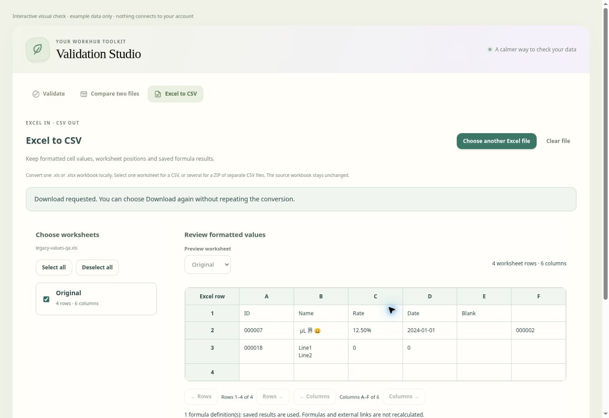

# Excel to CSV

In **Validation Studio**, choose **Excel to CSV** immediately beside **Compare
two files**. It is an independent workspace and does not require a validation
template. Upload an **XLS or XLSX** workbook, choose its worksheets, review the preview, then use
**Convert & verify** followed by **Download CSV**. Selecting several worksheets
produces one ZIP with a separate CSV for each worksheet in workbook order.
**Download again** reuses the verified result without repeating the conversion.

## Values and positions

The converter uses the displayed-value option confirmed for this feature:

| Source | CSV value |
| --- | --- |
| Numeric 7 with format `000000` | `000007` |
| Numeric 0.125 with format `0.00%` | `12.50%` |
| Excel date with format `yyyy-mm-dd` | The formatted date, using the workbook's 1900/1904 date system |
| Formula, including XLOOKUP | Its saved result, formatted using the result cell's number format |
| Text identifiers and formula-like text | Literal text, including leading zeros, long identifiers and spaces |
| Saved Excel errors | Literal text, such as `#N/A`, with a preview note |

Number formatting includes its displayed rounding; the CSV does not contain
hidden precision beyond that display. Built-in date displays may depend on
Excel's system locale, which is not stored in the workbook. The preview flags
these dates. Explicit unsupported locale/numeral formats, conditional number
formats, missing formula caches, values hidden by number formats and invalid
workbook structures stop the conversion with an explanation. No formula or
external link is executed or recalculated. Recalculate and save the source in
Excel if a cached result is missing or outdated.

CSV output preserves every position in the rectangular range occupied by explicit
worksheet rows and cells, including leading/interior blank rows and columns and
explicit trailing blanks. Formatting-only worksheet dimensions do not add empty
million-row regions. Hidden rows/columns are included. Hidden worksheets are
listed and can be selected. Merged values remain in their top-left position;
the other positions stay blank. Preview pages never restrict exported data.
Each selected worksheet is exported separately, without combining unrelated rows.

Every field is quoted with RFC-style doubled quotes and CRLF record separators.
UTF-8 with a BOM preserves Unicode. Commas, quotes, spaces, embedded CR/LF and
literal leading `=`, `+`, `-` or `@` are not modified. The source workbook and the
validation/comparison workspaces remain unchanged; uploaded values and resulting
files stay in browser memory and are cleared on an account change.

## Opening the result in Excel

CSV has no Excel cell types, styles, images or formulas. To protect codes and
identifiers when opening it in Excel, use **Data → From Text/CSV** and set those
columns to **Text**. Double-clicking a CSV lets Excel guess types and can remove
leading zeros or interpret formula-like text. The converter does not add
apostrophes or executable `="..."` formulas to disguise this limitation.

## Checks and bounds

Before enabling download, an independent streaming CSV parser reads the actual
generated UTF-8 bytes and compares every cell with the formatted source grid,
including blank edge positions, row counts and column counts. A mismatch offers
no file. Several worksheets are packaged only after each CSV passes this check.
Changing the source/worksheet selection invalidates the cached download. Reading
and conversion can be cancelled, and account/permission guards apply to upload,
conversion and download. No saved account records are written.

Limits are 50 MB per Excel workbook, 25,001 total worksheet rows per sheet, 1,000 columns,
6 million rectangular cells across the workbook, 32,000 characters per cell,
100 million formatted text characters and 250 MB combined CSV output. Limits
reject the file instead of truncating it. Binary Excel 97–2003 XLS (BIFF8) and
Excel 5/95 XLS (BIFF5) are supported directly. HTML/text files merely named `.xls`,
older BIFF versions, encrypted workbooks, chart/macro tabs and XLS conditional
formatting stop with instructions to save a suitable Excel copy. These cases
never fall back to guessed text parsing or silently skip sheets or records.

The XLS parser is loaded only when needed, in a fresh same-origin worker for
each upload. Cancel, account changes and page exit terminate the worker. The
original binary records are checked for complete worksheet streams, duplicate
addresses, supported formats, explicit blank positions and formula caches before
normalization. Tab order follows the workbook directory even if its physical
sheet streams use a different order. The same displayed-value formatter and CSV
verification apply to both XLS and XLSX. File comparison also supports XLS with
its existing saved-value rules; normal validation uploads keep their existing
supported formats.

`validator-files.js` implements an opt-in `displayValues` reader; the validation
and comparison defaults remain unchanged. `validator-csv.js` supplies encoding,
verification, in-memory download reuse and the independent workspace;
`validator-csv.css` styles its responsive worksheet/preview layout. Tests compare
the resulting CSVs with Python's standard `csv.reader`, in addition to source
format, cache, ZIP, cancellation, permission and workspace-isolation checks.

`vendor/ssf.js` is the unmodified SheetJS SSF **0.11.2** formatter from the
[official SheetJS repository](https://github.com/SheetJS/sheetjs/tree/master/packages/ssf),
retrieved 2026-10-31, with its Apache 2.0 license in `vendor/ssf.LICENSE`.
It formats numeric Excel serials locally; it does not run formulas or contact a
network service. It is loaded before the file reader and CSV workspace.

`vendor/sheetjs/xlsx.full.min.js` is the unmodified **SheetJS CE 0.20.3** full
browser build from the [official CDN](https://cdn.sheetjs.com/xlsx-0.20.3/package/dist/xlsx.full.min.js),
retrieved 2026-10-31, with its Apache 2.0 license in `vendor/sheetjs/LICENSE`.
The full build includes legacy codepage decoding. `validator-xls.js` starts the
worker; `validator-xls-worker.js` loads the local vendor and
`validator-xls-engine.js` checks and normalizes the BIFF workbook. No parser
code or uploaded file is sent to an external service.
