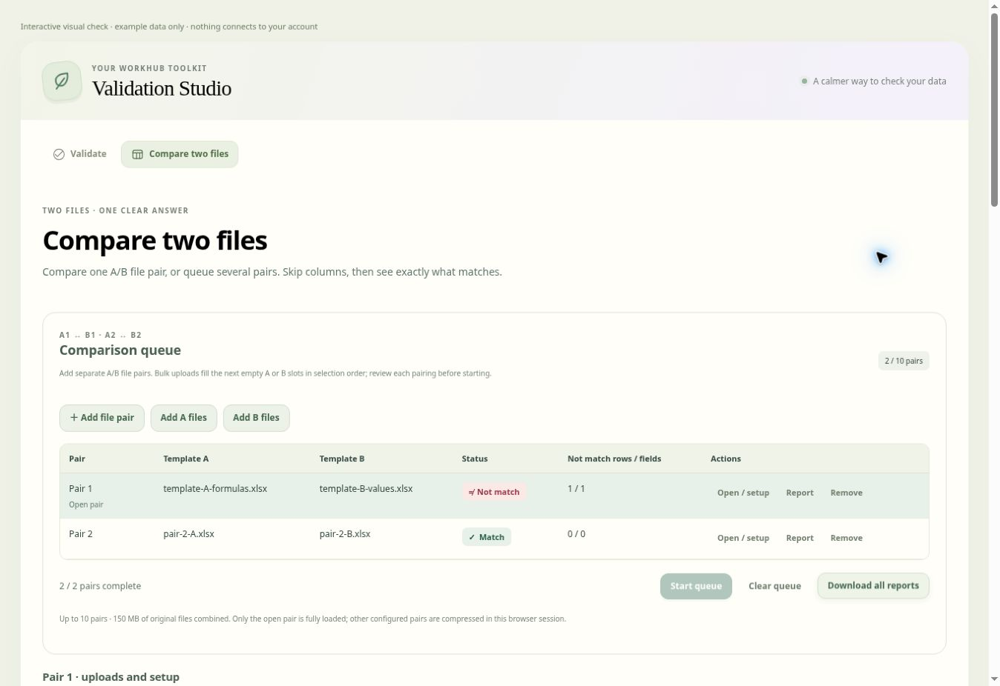

# Compare two files

**Compare two files** is a separate workspace in Validation Studio, beside
**Validate** and **Run validation**. It opens without a saved validation template.
Each comparison takes two independent uploads. Existing validation uploads,
preparations, exploded origins, mappings, rules and results stay in their own
validation workspace.

## Compare one pair

1. Open **Compare two files** and upload **Template A** and **Template B** (.xlsx,
   .csv or .tsv).
2. Select each file's worksheet and header row.
3. Choose one skip method for each file. **Enter a skip count** excludes that many
   columns starting at Column A: 0 keeps everything, 3 skips A–C and starts at D.
   **Choose with checkboxes** displays the actual column letters and headers; tick
   columns to exclude them. The inactive method does not apply.
4. Review **Column alignment**. Remaining columns are paired in order, first with
   first, then second with second. Header names are labels only: different header
   names do not cause Not match, and there is no automatic header remapping.
5. Click **Compare files**. Results show Match / Not match for the data rows and
   fields. Choose **View fields** to inspect both values and source worksheet rows.
6. Choose **Export comparison report** for the complete report described below.

## Queue separate A/B pairs

The comparison queue uses **A1 ↔ B1, A2 ↔ B2, A3 ↔ B3**. Each pair has its own two
files, worksheets, header rows and skip settings.

1. Use **Add file pair** for individual pairs, or select several files through
   **Add A files** and **Add B files**. Bulk uploads fill the next empty A/B slots
   in selection order. Review the visible filenames to check the pairing; use
   **Open / setup** and the replacement file inputs to correct a pairing.
2. Open each pair, choose its worksheets/header rows and exclusions, then click
   **Confirm pair setup**. Unreviewed or incomplete pairs need setup before the
   queue can start. A pair whose file cannot be read shows Failed and its error;
   other reviewed pairs can still run.
3. Click **Start queue**. Comparisons run sequentially. The table shows Needs
   setup, Ready, Running, Match, Not match or Failed, plus mismatch row/field
   counts. A failed comparison does not prevent later ready pairs from running.
4. **Stop queue** keeps completed results and confirmed setups. Start again to
   process waiting pairs; completed pairs do not run again.
5. Use **Open / setup** to inspect a completed pair, **Report** for its workbook,
   or **Download all reports** for a ZIP containing one workbook per completed
   pair. Failed and unfinished pairs are excluded from the ZIP. Filenames contain
   the pair number and both source filenames. The previously open pair is restored
   after a ZIP export.
6. Replacing a file or changing its worksheet, header row or skip settings clears
   that pair's result and requires its setup to be confirmed again. Other pairs
   keep their settings and completed results. **Clear pair** resets only the open
   pair's files; **Remove** removes one queue entry; **Clear queue** removes all
   comparison pairs and their browser-session data.

A standalone pair already open is retained as the first queue entry when more
pairs are added. No comparison data or summaries are written to Supabase or
validation run history.

## Excel report

Each workbook has two report sections, with **Summary first**:

| Sheet                | Contents                                                                                                                                                                                                                                                                                                                |
| -------------------- | ----------------------------------------------------------------------------------------------------------------------------------------------------------------------------------------------------------------------------------------------------------------------------------------------------------------------- |
| **Summary**          | Overall Match / Not match and counts, followed by one entry per data discrepancy. Each entry includes record number, both filenames, worksheet/row locations, column/field labels, both values and the reason (different values, missing row or missing column). Matching fields are omitted from the discrepancy list. |
| **Field Comparison** | Complete selected data, one record per row with A value, B value and Match / Not match for every paired field. Differences are highlighted.                                                                                                                                                                             |

Header-name differences are not reported and do not affect Match / Not match.
There are no separate Column comparison, Row comparison or old Comparison summary
sheets. Screen filters do not limit either report section. Large sections continue
on numbered worksheets with their headers repeated; no selected data is truncated.
The Summary's overall result row also identifies a pair with no data records, so an
empty dataset is not presented as a successfully checked set of records.

## Comparison and formula rules

Values compare exactly, including case, spaces, leading zeros and blanks. Rows are
paired in their existing order, including already exploded records. Put respective
records in the same order in both files. Blank rows between records keep their
positions; fully empty trailing rows are ignored. Repeated/empty column labels
retain their positions, and values beneath an unnamed header are included.

Keep at least one column in each file. Missing rows/columns produce Not match even
when the extra cells are blank. Missing data and an existing blank cell are distinct.
If neither file contains data, only remaining column counts can be compared; the
screen and report state that no data rows were checked.

Excel formula cells, including XLOOKUP, shared and array formulas, use their
**saved results**. The tool does not calculate formulas or refresh external links.
Recalculate and save in Excel first to refresh those values. A formula without a
saved result identifies its worksheet/cell and asks for recalculation/save rather
than silently becoming blank. Saved empty strings, zero, booleans and Excel errors
such as `#N/A` remain literal comparison values. Reports contain values, not
executable formulas. The normal validation/reference/setup readers retain their
existing formula rules.

## Capacity and session handling

Each source file supports 50 MB, 200 columns, 25,000 data records, 5,000,000 cells and
50 million text characters. Each queue supports 10 A/B pairs (20 files) and 150 MB
of original source files combined. Only the open pair has live workbook/data
arrays; inactive configured pairs are compressed in browser memory with a combined
100 MB compressed-session budget and a 300-million-character per-pair serialization
limit. Download and remove completed pairs to free capacity. ZIP exports are bounded
to 250 MB of completed workbook bytes; larger batches can be downloaded as
individual reports.

Comparisons cover all selected cells, including discrepancies beyond the validation
issue listing limit. Processing yields between batches and can be stopped. Report
generation uses generators and bounded worksheet splitting/compression.

Comparison files, configurations and results remain in this browser session and
clear on reload, sign-out or account change. Pending reads, compression,
comparisons and downloads cannot restore or export another session's data. Returning
to validation keeps its existing work; returning to comparison keeps its queue.
Existing Validation Studio Run/use and Export permissions apply.
