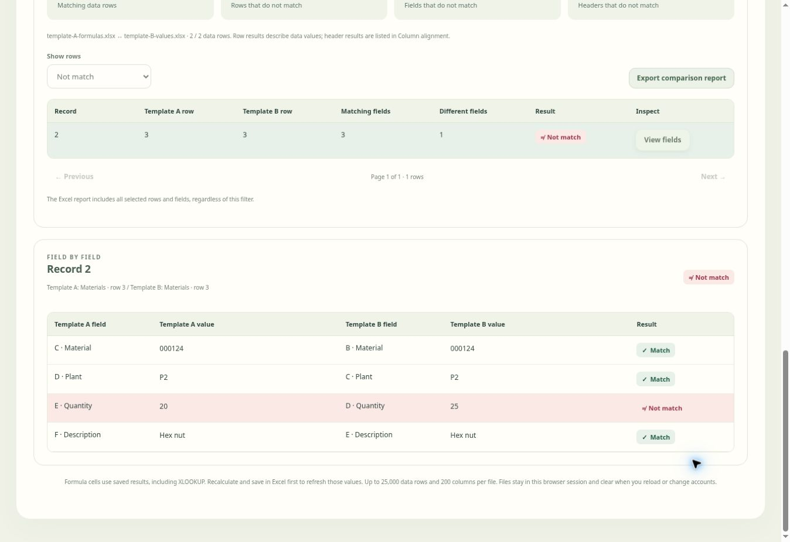

# Compare two files

**Compare two files** is a separate workspace in Validation Studio, beside
**Validate** and **Run validation**. It also opens from the welcome screen without
a saved validation template. It takes two new uploads; it does not reuse or change
the validation upload, preparations, exploded origins, mappings, rules or results.

1. Open **Compare two files**.
2. Upload **Template A** and **Template B** (.xlsx, .csv or .tsv).
3. Select the worksheet and header row separately for each file.
4. Choose one skip method for each file. **Enter a skip count** excludes that many
   columns starting at Column A: 0 keeps everything, 3 skips A–C and starts at D.
   **Choose with checkboxes** displays the file's actual column letters and
   headers; tick any columns to exclude them. The inactive method does not apply.
5. Review **Column alignment**. The first remaining column in A pairs with the
   first remaining column in B, then the second with the second. There is no
   automatic header remapping or record sorting.
6. Click **Compare files**. The report gives an overall Match / Not match, separate
   header results, data-row results, and a field-by-field view of each record.
   Choose **View fields** on a row to inspect both values. Different values and
   absent rows/columns are highlighted; a missing value is distinct from a blank
   cell. The row numbers refer to the selected source worksheets.
7. Choose **Export comparison report** for the full Excel report: Comparison
   summary, Column comparison, Row comparison and Field comparison. Screen filters
   do not limit exports. Large sheets continue on numbered worksheets with their
   headers repeated. Differences are highlighted in Excel as well.

The example below compares two independent uploads. Template A contains saved
XLOOKUP and SUM results. After skipping the leading metadata columns, one quantity
differs: 20 in Template A and 25 in Template B.

## Comparison rules

Rows are compared in their existing order. Put corresponding records in the same
order in both files, including already exploded records. Blank rows between records
keep their positions; completely empty trailing rows are ignored. Columns with
empty or repeated headers retain their original column positions, and data beneath
an unnamed header is included. Keep at least one column in each file. Different
remaining column counts and extra rows produce Not match results, even when the
extra cells are blank.

Header text and data values are compared exactly, including case, spaces, leading
zeros and blanks. A header difference affects the overall result; a data-row result
describes only that row's values. Files with headers but no data show that only
headers were compared.

Excel formula cells (including XLOOKUP, shared formulas and array formulas) use the
**saved result**, never the formula source. The tool does not calculate formulas
or refresh external links. Recalculate and save workbooks in Excel before upload
to refresh those results. A formula without a saved result stops the upload with
its worksheet/cell address and instructions, rather than treating it as blank.
Saved empty-string, zero, boolean and Excel error results are preserved as values.
Excel errors such as `#N/A` are compared literally. Reports contain literal values,
not executable formulas. The existing validation/reference/setup upload rules
continue to reject formulas; only this independent comparison enables saved-result
reading.

## Capacity and session handling

Each file uses the existing reader limits: 50 MB, 200 columns, 25,000 data records,
5,000,000 cells and 50 million text characters. Comparisons cover every selected
cell; the validation issue listing limit does not truncate comparison results.
Comparison processing yields between batches and can be cancelled. Reports use
generators and the existing bounded worksheet splitting/compression.

Changing a file, worksheet, header row or skip setting clears the previous result
and export action. Returning to validation keeps its existing work intact; returning
to comparison keeps the two comparison uploads until cleared. Uploaded data stays
in browser memory. Reload, sign-out or account change clears both comparison files;
pending reads, comparisons and exports cannot restore or download another session's
data. No comparison file contents or summaries are saved to Supabase or run history.
The existing Validation Studio Run/use and Export permissions apply.
