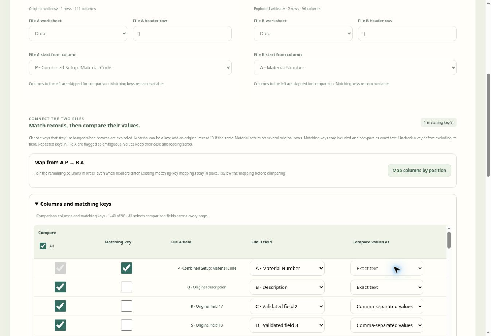
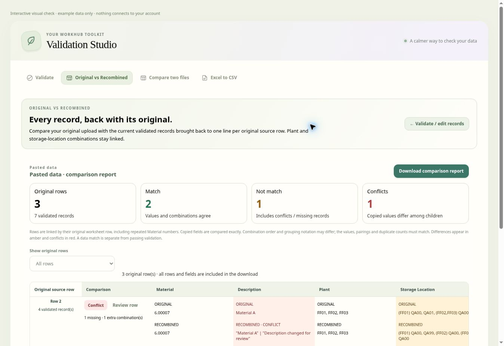

# Original vs Recombined · two independent files

Open **Validation Studio → Original vs Recombined**. This workspace compares an original file with a separate exploded or validated file. It works without a saved template or a validation run. The files uploaded in Validate, Compare two files and Excel to CSV have separate working sessions.

## Use the comparison

1. Upload **Original file A** — normally one line per original record.
2. Upload **Exploded file B** — the separate file containing its expanded records.
3. Choose the worksheet and header row independently for each file.
4. Optionally choose **File A start from column** and **File B start from column**. Each dropdown uses that file's actual column letters and headers. Choosing D skips A–C from comparison. Matching keys remain available before either start.
5. Review **Columns and matching keys**. Matching headers map automatically. If the remaining columns follow the same order, choose **Map columns by position** to pair them all from the selected starts, even when headers differ. Review the result and adjust individual exceptions. Check the unchanged columns that identify a record, such as Material or Material + Original Record ID. A recognised, uniquely mapped Material/ID field is selected initially when there is exactly one clear candidate. Use **All** under Compare to select or clear the eligible non-key fields across every page; matching keys stay separately selected.
6. Choose **Recombine & compare**. File B is grouped by those exact keys, and distinct field values are joined with commas. There is no prerequisite to run validation.
7. Review the highlighted fields or choose **Review record** for assignment details and source File B rows. **Download comparison report** exports the whole comparison, regardless of the current screen filter or page.

Matching key fields stay included and compare as exact text. Uncheck a key before excluding its field. Use keys that do not change when the record is exploded. If the same Material appears on two different original lines, choose an additional unchanged identifier; otherwise both original records show **Ambiguous key**, and their File B values remain unassigned. The program does not choose one description or merge two original rows by guessing.

Blank keys, missing File B records and extra File B keys are displayed separately. Matching uses keys rather than worksheet order. Changes to uploads, worksheets, mappings or comparison settings clear the old result and require another comparison. Headers are labels rather than discrepancies. An eligible, selected File A field without a File B mapping is reported as a missing File B column. File B columns not mapped for comparison are listed in the setup.

## Comparison ranges and bulk selection

A non-key field is eligible when its File A column is at or after File A's start and its mapped File B column is at or after File B's start. An unmapped File A field within the range stays available so that a missing mapping is reported. The main table begins with eligible fields and any selected matching keys. Earlier fields are collapsed under **Show skipped columns**; open it to inspect them or select a key before the start. Skipped fields have an unchecked, disabled Compare box. A selected matching key before either start appears in the main table with **Matching key kept before start** and continues to identify records and compare exactly.

The **All** checkbox is checked when every eligible non-key field is selected, shows a partial mark when only some are selected, and is disabled when no non-key fields are eligible. It preserves matching keys, mappings, and manual choices outside the range. Widening the range restores those previous field choices. Changing a start does not remap columns or change the selected matching keys. Replacing a file or changing its worksheet/header resets that file's start to A; clearing files or changing account resets both.

For example, File A can have Material in A and Plant in C, while File B has Material in B and Plant in D. Start File A at C and File B at D to compare Plant and subsequent mapped fields, while Material remains the exact matching key.

### Bulk positional mapping and large column sets

**Map columns by position** pairs the suffixes without matching header names. If File A starts at P and File B starts at A, it pairs P → A, Q → B, R → C, and so on. An original file with 111 columns starting at P has 96 remaining columns, so it can map to a 96-column File B in one action. Starting-column selection itself preserves existing mappings; use the button whenever you want to rebuild them by position.

Selected matching keys retain their mappings, including before the starts. A proposed target already reserved by a different matching key stays unmapped and is reported for review. A missing corresponding File B column stays unmapped, and extra File B columns are counted. The operation preserves field inclusion choices, value comparison modes, and mappings before File A's start. It does not choose new matching keys automatically. If there are no keys, select the material/record identifier after reviewing the mappings.

The table shows 40 mapping rows per page, supporting up to 200 upload columns without creating every dropdown at once. Skipped rows are rendered only when expanded and are also paged. **All** works across every page. Pagination and expanding skipped columns leave the current comparison and export intact; changing a mapping invalidates both. Page changes, starting-column changes and bulk mapping bring the relevant mapping table back to its top. Reports still contain every effective field, including fields on other mapping pages.

## Comma values and exact text

| Setting | Behavior |
| --- | --- |
| Matching key | Literal text, including case, spaces and leading zeros |
| Comma-separated values | Distinct comma-delimited items; ignores item order and spaces around each item |
| Exact text | The complete File A text must equal the comma-joined, distinct File B text |

For example, File B values `FF01`, `FF01`, `FF02` become `FF01, FF02`. Storage values `QA00`, `QA01`, `QA00` become `QA00, QA01`. Repeated exploded rows do not add new distinct values. Descriptions default to Exact text so punctuation and spaces in ordinary prose retain their meaning; choose Comma-separated values if an original field is maintained as a list.

If File A says `Water Pump` and File B contains both `Water Pump` and `Water Pump Updated`, its recombined description is `Water Pump, Water Pump Updated` and is highlighted as **Not match**. A data discrepancy is a comparison result, not a Validation Studio condition or validation error.

## Parent / dependent assignments

The optional assignment check compares distinct relationships as well as the individual field values. It is initially selected when Plant/WERKS and Storage Location/LGORT are clearly mapped. You can select other mapped parent/dependent fields, or switch the check off. Excluding or unmapping one of the assignment fields, including moving it before a starting column or clearing it with All, switches that check off and displays a status message. After restoring both fields, enable the check again if required. Recognised grouped values can still be compared as lists.

File A supports the current grouped notation and positional lists, detected per row:

| File A plants | File A storage locations | Expected pairs |
| --- | --- | --- |
| `FF01, FF02, FF03` | `(FF01) QA00, QA01, (FF02,FF03) QA00` | FF01/QA00, FF01/QA01, FF02/QA00, FF03/QA00 |
| `FF01, FF02` | `QA00, QA01` | FF01/QA00, FF02/QA01 |

File B should have one parent/dependent value per expanded row for assignment checking. Wrong pairings are highlighted even if the two independent comma lists contain the same codes. Review record shows the actual missing and extra pairs. Different group notation alone is not a discrepancy for comma-list comparisons. Exact text remains literal when explicitly selected.

Malformed groups, unknown parents or unsupported formats are flagged as **Review assignments** rather than guessed. A single parent with multiple plain dependent values requires explicit grouping; plain lists continue to pair by position. Additional source formats are deferred to a later batch.

## Exported report

The workbook contains exactly two sheets:

| Sheet | Contents |
| --- | --- |
| **Summary** | Overall counts and every non-matching/review record, with original and recombined field values, source row references, and missing/extra assignment details |
| **Field Comparison** | Every comparison record and mapped field, showing File A, recombined File B, and the field result side by side |

The report includes the effective selected fields and all matching keys. Skipped prefix fields are excluded. Summary records the starting column for each file so the comparison range is clear.

Values are literal Excel text, including identifiers and formula-like strings. Formula source is not executed or exported as an Excel formula. A recombined value longer than 32,000 characters continues on additional rows in the same two sheets, labelled with the comparison record and Part number. Joining those parts reconstructs the full value. Unicode characters, including surrogate pairs at continuation boundaries, remain intact. Screen previews shorten long values; the report retains the complete contents. Repeated downloads reuse the generated workbook until inputs or settings change.

## Input values, limits and privacy

XLS, XLSX, CSV and TSV are supported using the existing local readers. Excel formulas, including XLOOKUP, use their saved results. Recalculate and save the workbook in Excel first; a missing saved result stops the upload rather than becoming a blank match. XLS retains its existing saved-value comparison rules. XLSX numeric identifier display metadata is used for matching keys and Material fields; literal text, leading zeros, long identifiers and normal measure values retain the existing saved-value rules. Already incorrect source text cannot be repaired by guessing intended digits.

Each input supports 50 MB, 25,000 data records, 200 columns and 5,000,000 cells, subject to the existing text limits. Recombination does not expand these input files. Large comparisons yield between batches and can be cancelled. Uploaded data, mapping, results and generated workbooks remain in this browser session. No upload or report contents are saved to account records. Account changes and reloads clear the working session; late reads/runs/exports are discarded. Run/use permission enables the tool, and Export permission separately controls downloads.

## Existing explode preparation

**Validate → Explode & map rows** continues to provide the existing positional mode and **Parent + dependent · grouped or plain per row**. The grouped example above still produces four expanded records. Every unselected field, including Material and Description, is copied from that same source row. Invalid or incomplete groups block Apply. Undo, original row/part lineage, validation queues and numeric identifier preservation continue to apply to validation uploads. See [Validation preparation](VALIDATION-PREPARATION.md).

## Verification

`tests/validator-reconcile.test.mjs` covers operation without a template or validation run; separate file uploads; distinct comma lists; literal text and identifiers; crossed parent/dependent pairs; repeated and blank keys; missing/extra records; mapping exclusions; source row order; independent worksheets/headers; cached formulas; XLS worker routing; cancellation; account isolation; complete two-sheet exports; long/Unicode continuation values; and 12,000 originals compared with 24,000 separate exploded records. The existing validation session is checked for unchanged upload, mapping, results and history. Range/bulk checks cover checked/partial/clear states; preservation of keys and mappings; independent starts and reordered source rows; report invalidation and effective field export; assignment exclusion; choices restored when ranges widen; invalid starts and columns after Z; and file/worksheet/account reset behavior.

Current local checks: 296 validator/source checks and 25 focused application integration checks passed (321 total). A subsequent 35-check focused comparison/source run also passed after refining mapping-page scroll behavior. Formatting and diff checks passed. The new checks include 111-to-96 positional mapping, protected keys and unmapped targets, collapsed prefixes, 200-column paging and all-page selection, and report completeness. `tests/validator-upload.test.mjs` covers sparse introductory rows, all 200 source positions after choosing header row 4, read failure/retry, empty-header recovery, and stale/account-switched failures.

Current browser QA uploaded a deliberately invalid workbook, confirmed the reading banner disappeared and a readable retry error appeared, then successfully uploaded an Excel file with sparse introductory rows. Choosing header row 4 mapped Material at P, Description at Q, Plant at R and Storage Location at S; the record passed with literal Material `000001` and its correct description. Separate 111-column and 96-column CSVs then mapped P → A through DG → CR in one action. Page-three deselection produced a partial All checkbox; restoring All produced a Match across all 96 fields from two exploded rows. Opening/collapsing the 15 skipped columns preserved that result.

A local 1,000-original / 2,000-exploded-row comparison with 200 fields completed in 414 ms, retaining the final key `000999` and final field `Value 999:199`. This is one local measurement, not a timing guarantee. The normal mapping page renders 40 rows and fewer than 10,000 option elements for a 200-column input, rather than over 40,000 options for an unpaged table.

Earlier standalone-comparison verification also timed a synthetic 12,000-original / 24,000-exploded-record comparison and its two-sheet workbook at 1.48 seconds (1,252,804 bytes) locally. An independent Python ZIP/XML reader verified exactly Summary and Field Comparison, every record, the final literal material ID, discrepancy values, highlights, Unicode and absence of formulas. This is a local check, not a timing guarantee for every browser or workbook.

Earlier browser QA used two separately uploaded CSV files with no saved template and no validation run. It confirmed six exploded rows recombined into two records, one Match and one Not match, comma-joined descriptions/storage values, correct material IDs, and missing/extra plant/storage details. Browser download-event confirmation timed out; generated workbook bytes and all report rows were verified independently.
