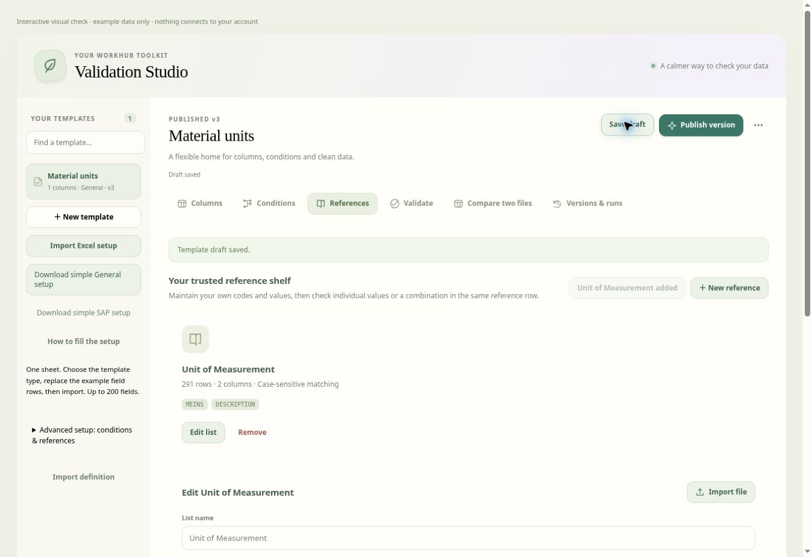
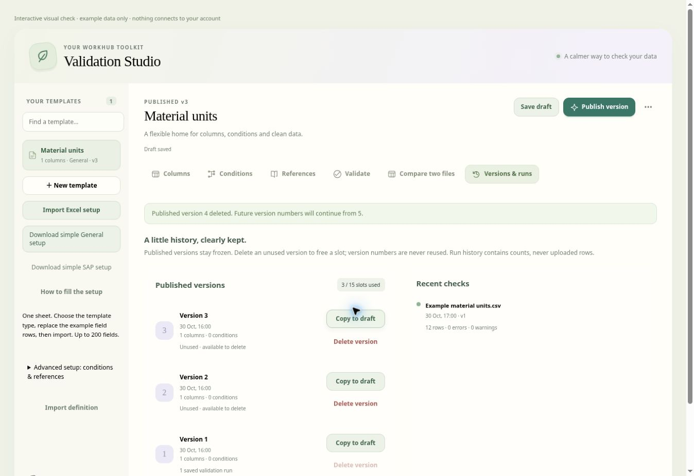

# Unit of Measurement and published-version cleanup

## Add the maintained unit reference

1. Open a template draft and choose **References → ＋ Unit of Measurement**.
2. The list contains the supplied **291 MEINS codes** and their **DESCRIPTION** values. Review the list, then **Save draft**.
3. In **Validate**, choose **Current draft** (or publish and select the new version).
4. Keep the unit field as **Text** in General templates or **UNIT** in SAP templates to retain code semantics and leading zeros. Under **References · choose individually → Map another reference check**, choose your uploaded unit field, **Unit of Measurement**, and **MEINS**. Choose **Add reference check**. The resulting checkbox uses the existing individual-selection and condition-dependency behavior. Save a validation profile to reuse the mapping.
5. Alternatively, select the list in a condition's **exists in reference** or **combination exists in reference** requirement. Matched descriptions appear in the existing reference details and exported Reference matches.

The preset is an independent, editable list in each template, added only when requested. It keeps leading zeros (`000`, `001`), symbols (`µL`, `°F`, `"2`) and the supplied capitalization. `001` has an intentionally blank description; its code remains valid. Descriptions retain their supplied wording; Markdown escapes around asterisks and periods are presentation syntax rather than stored backslashes.

**Case-sensitive reference matching** starts enabled for this list: `BTL` means Bottle, while `btl` means Btu/lb. Incorrect variants such as `Btl` fail. The setting applies to reference checks, explanations and suggestions, including combined fields; it does not change the column's other comparisons. Existing references keep their field-based matching unless this setting is enabled. Blanks continue to follow the selected condition and Required column settings.

Adding or editing the list changes the draft. Previously published versions keep their frozen definitions. JSON definitions, backups, template/condition copies and queued validation schemas retain reference metadata and exact matching. Data-template Excel exports include the full readable reference values; they are not template-definition backups.

## Delete an unused published version

Open **Versions & runs → Published versions**. Each entry shows its usage, **Copy to draft**, and **Delete version**. The heading shows occupied slots out of the existing 15-version limit.

Deletion is available only when the version has no retained saved validation runs and is not used by an active result, prepared upload or queued file in this session. A disabled button has a visible reason and tooltip. Clear the relevant upload/queue or use a different version when appropriate. Saved run usage protects the version while those summaries remain in history. Profiles use whichever version is selected at run time, so they do not independently pin a version.

Deleting requires both template edit and delete permissions because versions are saved inside the template. The confirmation identifies the template and version and suggests exporting its definition first. It removes the selected frozen definition immediately through the normal workspace save path. Unsaved draft edits remain unsaved, other versions and saved run summaries remain intact, and optimistic timestamp checks prevent replacing changes from another device. If the removed version was selected without an active result/preparation/queue, validation switches to **Current draft**.

The next publication number always increases. For example, after deleting unused version 5, the next publication is version 6. This counter survives definition export, backups and reopen, including when all versions were deleted. Independent template copies start a new series. Old templates without the counter continue to work; retained releases and run summaries supply the initial high number. Explicit full backup restoration retains its existing restore behavior.

Retained releases remain immutable. The state boundary also blocks deleting a version used by saved runs, changing a retained release, lowering a saved counter or reusing a previous publication number. Queue and current-upload checks apply in the owning browser session; uploaded data and queues are not persisted to the account.

