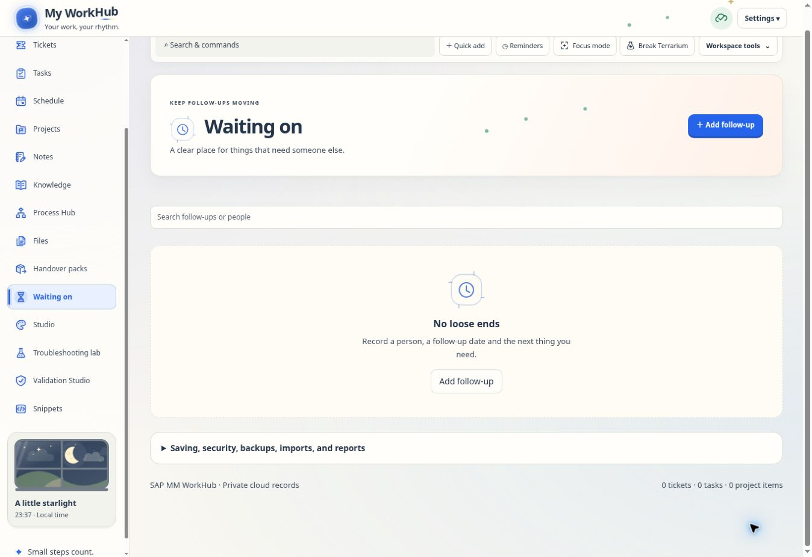

# Shared visual refinement

The visual refresh applies to the existing 15 workspace sections and follows the saved theme, design, radius and motion preferences.

| Enhancement | Result |
| --- | --- |
| Consistent styling | Shared surfaces, borders, shadows, controls and spacing derive from the current theme. |
| Navigation indicator | A thin accent moves between the original active route buttons, horizontally or vertically according to the layout. |
| Page transitions | Route changes use a short opacity fade. Typing and pointer interaction cancel it immediately. |
| Section headers | Each section has a local SVG mark and a soft accent; the My Day landscape keeps its own art. |
| Typography | Stronger heading hierarchy, readable descriptions, balanced headings and clearer summary labels. |
| Card feedback | Pointer hover highlights work cards; clickable overview cards receive a small lift. Drag surfaces do not move on hover. |
| Status badges | Known shared statuses receive a labelled semantic tint and a dot. Custom status names retain their existing treatment. |
| Dialogs and forms | Coordinated corners, spacing, focus rings and clearer ticket form sections. |
| Empty states | Existing messages and actions receive section illustrations and a coordinated empty-state surface. |
| Dashboard composition | Clearer dashboard groups, segmented filters, widget hierarchy and phase accents preserve the saved widget order and spans. |

`visual-refinement.js` owns the presentation lifecycle and local section art. `visual-refinement.css` is loaded after the shared layout sheet and before `custom.css`, so personal overrides remain last. `app.js` mounts presentation after the existing render/decorate path and adds semantic metadata to shared tags. `website-designs.js` requests a navigation measurement after regrouping.

The layer does not store records, replace route controls or remount working inputs. Navigation measurements are coalesced into one animation frame and react to resize rather than scrolling. There are no new continuous animation loops or remote image requests. New effects respect Motion off, reduced motion, hidden pages and the existing paused-effects mode.

## Verification

- Component checks cover retained controls, drafts, focus/caret position, same-route updates, hidden routes, reduced motion and sign-out cleanup.
- The application check visits all 15 sections, verifies the original navigation buttons and retains an unfinished editor without record changes or extra database writes.
- Existing website-design, theme-colour, render-profile, animation-performance, My Day and dialog checks cover shared integrations.
- Browser review uses a synthetic local account. Desktop checks cover the current design, dark mode, Fiori and Compact Pro; a 390px embedded viewport checks horizontal navigation, page wrapping, forms and Motion off.
