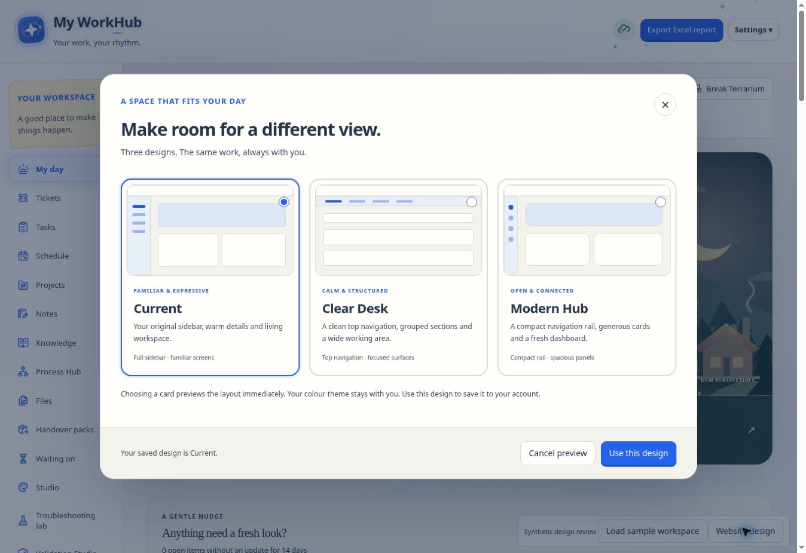
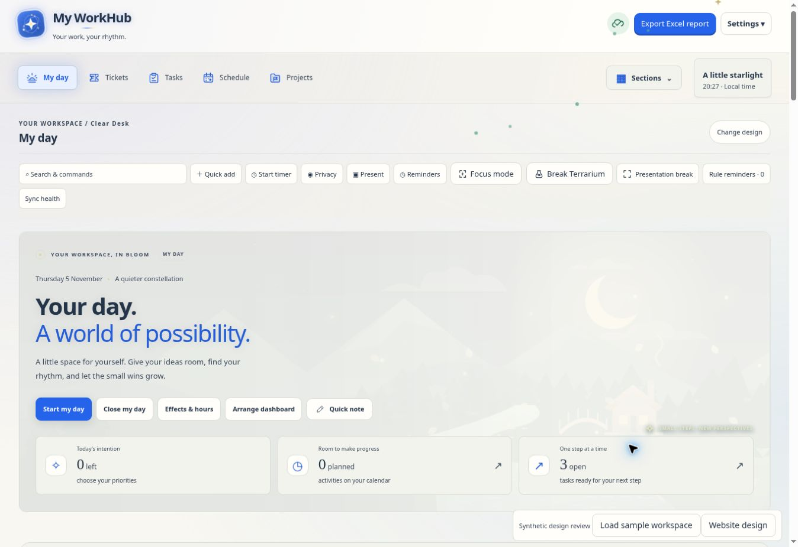
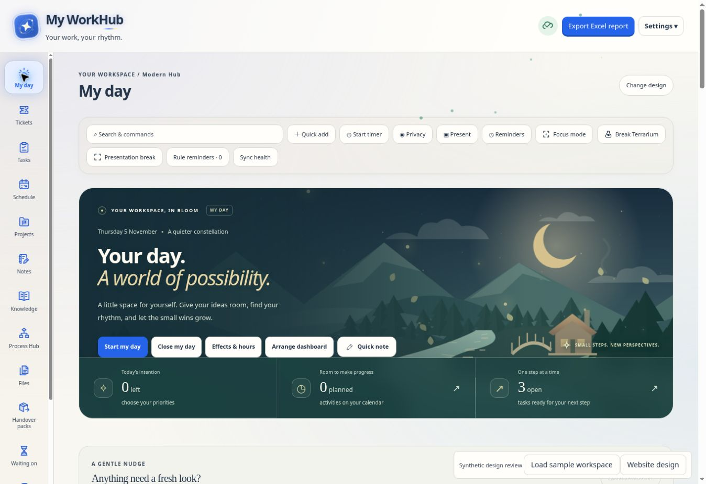
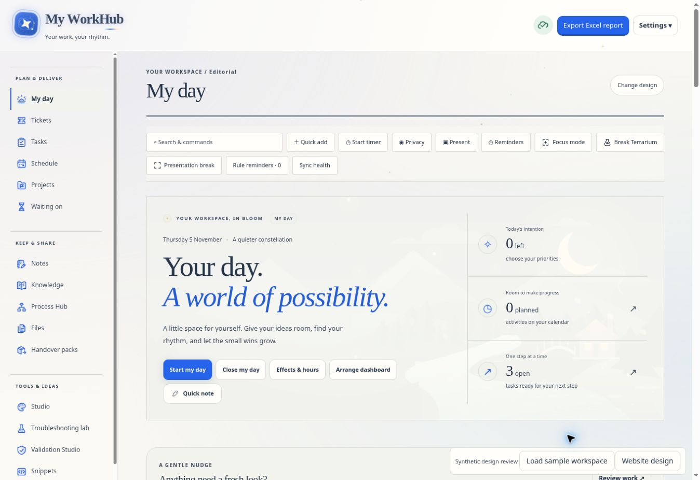
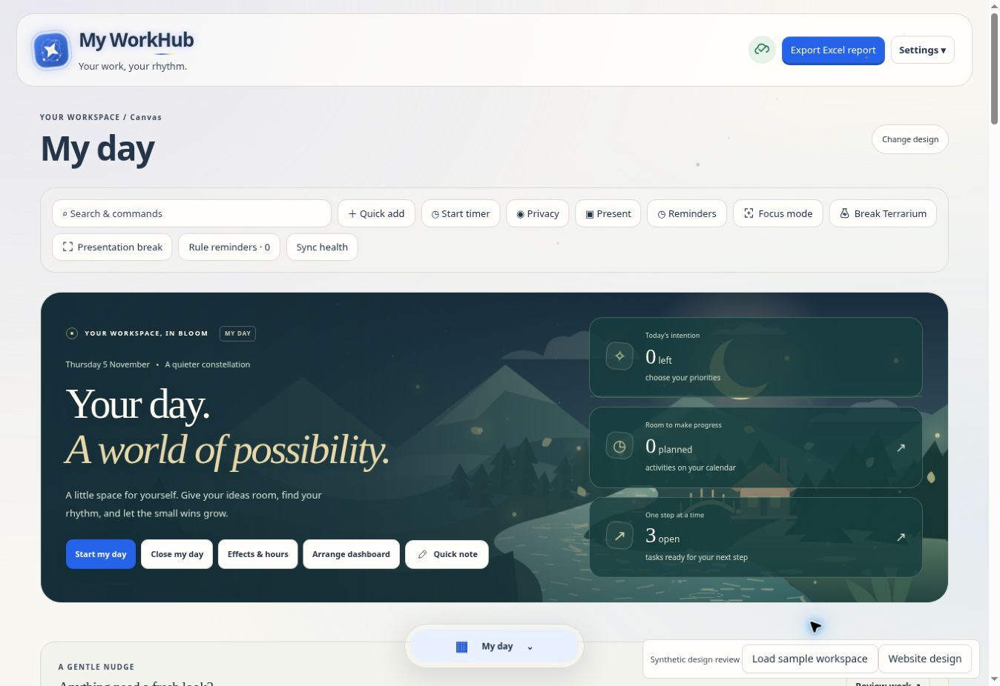
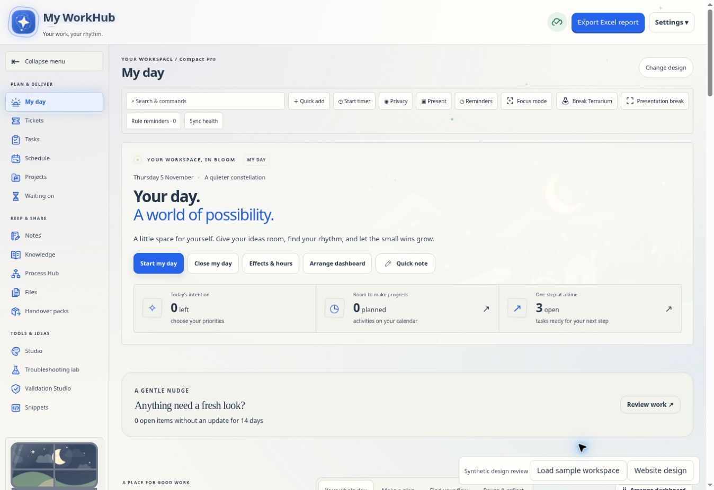

# Website designs

Open **Settings → Website design**, select a card to preview, and choose **Use this design** to save. **Cancel preview**, Close or Escape returns to the saved design. The chooser is also available under **Appearance & motion**, above the colour choices. Alternate layouts include a **Change design** button beside the section heading.

| Design      | Desktop                                                                                      | Phone and narrow windows                                                                            |
| ----------- | -------------------------------------------------------------------------------------------- | --------------------------------------------------------------------------------------------------- |
| Current     | Existing full sidebar, familiar screens and expressive workspace                             | Existing responsive navigation                                                                      |
| Clear Desk  | Primary top navigation, grouped Sections menu, wider working area and quieter surfaces       | All sections in the top section picker                                                              |
| Modern Hub  | Compact labelled rail, spacious panels and rounded cards                                     | Bottom dock for My day, Tasks, Schedule and Projects; grouped section picker for the other sections |
| Editorial   | Grouped index sidebar, magazine-style headings and divided panels                            | Top section picker and stacked reading panels                                                       |
| Canvas      | Floating section launcher, open workspace and dashboard tiles; three columns on wide screens | Floating launcher with a scrollable section menu                                                    |
| Fiori Workspace | SAP Fiori-inspired shell navigation, object headers, structured sections and clear status cues | Top section picker, stacked forms and responsive cards |
| Compact Pro | Grouped collapsible navigation, compact toolbars and denser tables                           | Top section picker and larger touch controls                                                        |

My day keeps its full-colour scenery, readable scenic foreground and responsive landscape spacing in every design. Design changes style its frame without fading the artwork or replacing its contrast shade and metric layout.

Colour palettes, custom colours, motion preferences and companion settings remain separate from the design choice. All 15 existing sections use their original navigation controls and feature modules. Navigation groups respect existing access restrictions.

## Preference and save behaviour

The optional `workhub.preferences.design` value is `current`, `clear-desk`, `modern-hub`, `editorial`, `canvas`, `compact-pro` or `fiori`. Missing values mean Current, so old accounts and backups need no migration or default write. Explicit selection uses the existing personal settings save path and Workspace edit permission. It follows the account through ordinary cloud saves and backups. No database schema change is required.

Preview changes presentation only and never writes records. Saving a design updates that single preference. During that synchronous save, `app.js` refreshes the shell without replacing the working view or editor DOM. Unsaved project cells, open forms, uploaded validation files and exact cell values remain in place. Ordinary edits and cloud conflict checks still use the existing save pipeline. Account changes, sign-out or a changed saved preference discard an open preview.

`website-designs.js` owns the chooser, account context, navigation grouping and context bar. It moves the real navigation buttons rather than cloning routes. Grouping runs only when the layout, breakpoint or navigation nodes change. `website-designs.css`, `website-designs-extra.css` and `website-fiori.css` scope alternate layouts to the body design attribute and use existing theme tokens. There are no additional animation loops, polling timers or network requests.

## Verification

The My day scenery fix was checked in a browser using the real styles and synthetic counts across all seven designs at 390, 900 and 1200 pixels, in lavender/day and dark/night settings (42 combinations). The landscape and contrast shade remain fully visible, scenic headings keep their light foreground, metric buttons stay inside the header without overlapping its content, and the page has no horizontal overflow. All 40 focused design, theme, My day, animation-performance and source-layout checks passed.

The design tests cover preview/cancel, save/reload/backup, account and permission changes, save conflicts, navigation identity, all 15 sections in all seven designs, live project editing, retained validation uploads including `001` and `6.00007`, and colour preview compatibility. A local database test verifies the existing personal settings permission path and legacy records. Compact Pro’s menu collapse is a local view state; it does not write records, and resets when the account changes. Earlier browser review of the first six designs covers desktop and 390-pixel phone layouts, section pickers, dark colours and Process Hub fullscreen/return.

Fiori Workspace uses the current colour tokens, focus indicators and existing control nodes. It introduces no UI5 runtime, remote fonts, background animation or data migration. The handover preview and PDF use coordinated object headers, semantic status labels and grouped sections; the PDF uses a light print palette. Automated coverage includes Fiori selection/cancellation, desktop/mobile navigation identity, persistence and source protection. A new visual browser review requires an available preview environment.

Synthetic preview screenshots of the earlier designs:

